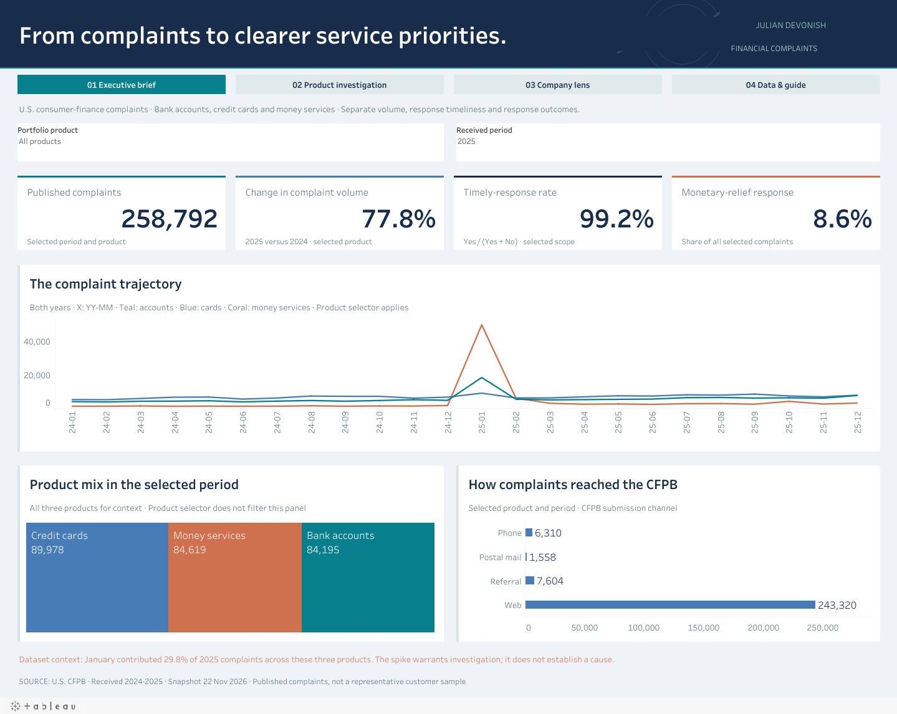
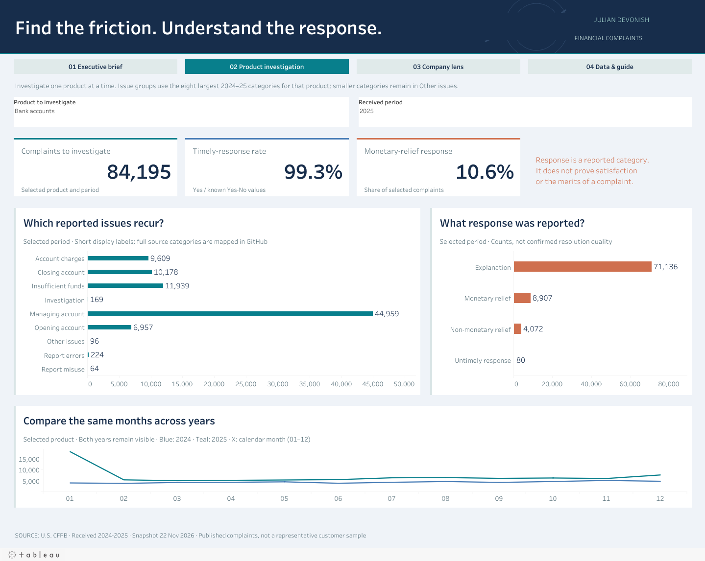
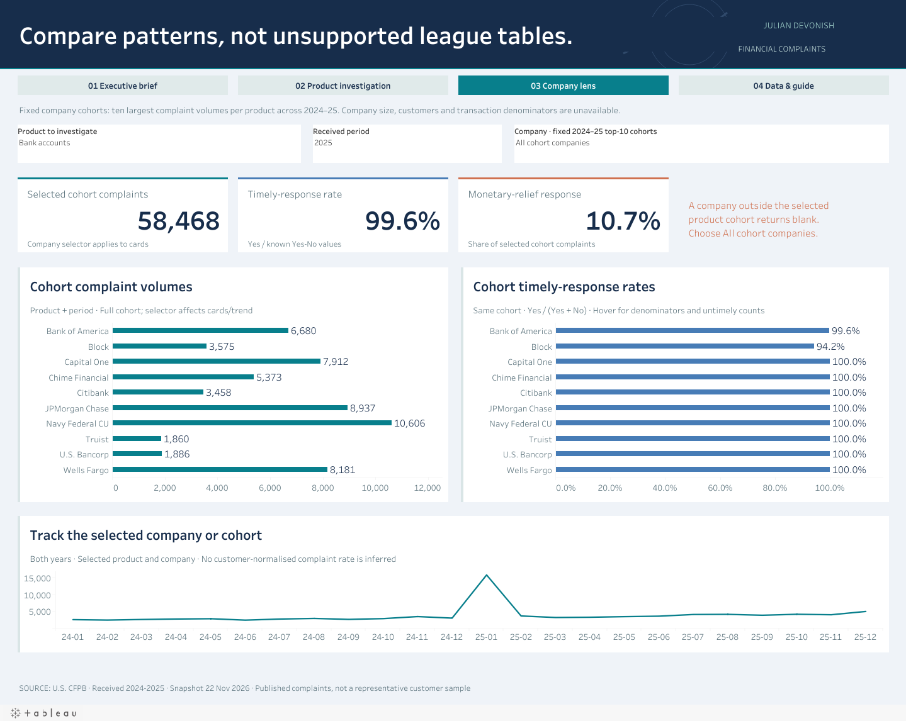
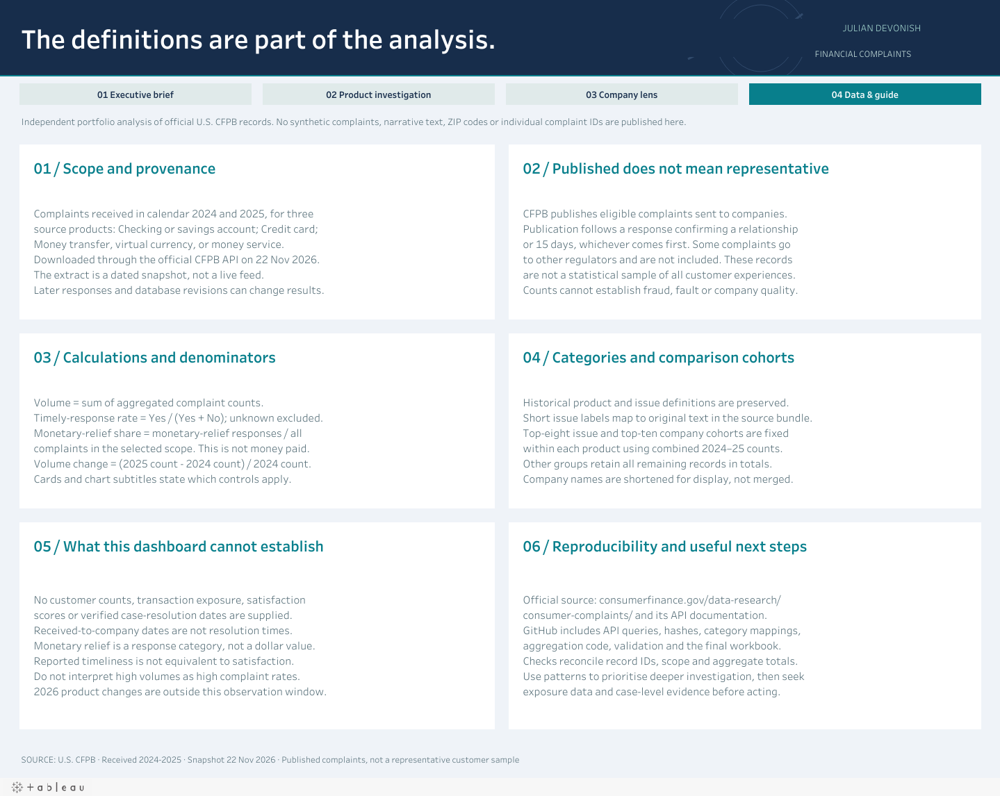

# Financial Complaints Intelligence | Customer Experience & Company Responses

**Julian Devonish · Independent Tableau portfolio project · 22 November 2026**

[Open the live dashboard](https://public.tableau.com/app/profile/jul.dev/viz/FinancialComplaintsIntelligence/01ExecutiveBrief) · [Download the Tableau workbook](Financial%20Complaints%20Intelligence.twbx) · [Source, mappings and validation bundle](Financial-Complaints-Intelligence-source.zip)

## Business question

Where do reported customer problems concentrate, how do complaint volumes change, and what company-response patterns warrant deeper investigation? This project supports a financial-services operations or customer-experience conversation. It deliberately separates complaint counts, timely-response percentages and reported response categories.

## Real-world data and access

The [U.S. Consumer Financial Protection Bureau Consumer Complaint Database](https://www.consumerfinance.gov/data-research/consumer-complaints/) provides public downloads and an [official API](https://cfpb.github.io/api/ccdb/api.html). The project downloaded six product-year CSV exports on **22 November 2026**, covering complaints **received in 2024 and 2025** for three source categories:

| Display product | Original CFPB product | 2024 | 2025 |
| --- | --- | ---: | ---: |
| Bank accounts | Checking or savings account | 52,821 | 84,195 |
| Credit cards | Credit card | 75,989 | 89,978 |
| Money services | Money transfer, virtual currency, or money service | 16,751 | 84,619 |
| **Total** | **Selected three-product scope** | **145,561** | **258,792** |

There are **404,353 distinct complaint records** across the exports. This is not the entire CFPB database. The snapshot may include responses or revisions recorded after the complaint-received period. Observation dates and retrieval dates are distinct. The dashboard is published as a fixed snapshot, not an automatically refreshing live feed.

CFPB explains that only eligible complaints sent to companies are published, following a response confirming a commercial relationship or 15 days, whichever occurs first. Some complaints are referred to other regulators. The database is **not a representative statistical sample** of customer experiences. Company size, customer counts and transaction exposure are not provided here. A large complaint count cannot establish a high customer complaint rate, company fault or poor service quality.

## Preparation and reproducibility

1. Read the official database methodology and field reference before choosing measures. Used two complete received-date years, outside the 2026 product-option changes.
2. Downloaded one CSV per product and year through the public API. The API export requires a size argument but exports the full filtered set; independent `hits.total` queries checked that every export contained the expected count.
3. Checked complaint-ID uniqueness, received-date bounds and exact source-product membership. Retained all matching records, including small categories.
4. Aggregated to **23,695 rows** at month × product × issue group × company group × response × timely flag × submission channel. Complaint counts reconcile to all 404,353 source records.
5. Built a Tableau Hyper extract and a native packaged workbook with **20 worksheets, four dashboards, parameters, calculated fields, treemap, trend lines, comparison bars and native navigation**.

The public workbook and source bundle exclude consumer narratives, ZIP codes, tags and complaint IDs. They retain only grouped operational facts. Full downloaded exports remain local; reproducibility files contain query URLs, SHA-256 hashes, preparation code, aggregate data and category mappings.

To reproduce, install Python dependencies `requests` and `tableauhyperapi`; run `download.py`, `prepare.py`, `validate.py`, then `build.py`. The builder references the local bundled Hyper runtime; use your installed `tableauhyperapi` if that path is unavailable. `make_builder.py` is the local development scaffold; the standalone `build.py` is included for reproduction.

## Dashboard navigation and filter behaviour

| View | What to investigate | Filter scope |
| --- | --- | --- |
| Executive Brief | Total complaints, annual change, timely responses, monetary-relief share, monthly trajectory, product mix and submission channels | Product and received-period selectors affect the labelled cards/charts. The monthly line retains both years; the product treemap always shows all three products for context. |
| Product Investigation | Which reported issues recur and what response categories were reported? | One focus product and period. The year-overlay line retains both years so the same months can be compared. |
| Company Lens | Compare volumes and reported timeliness within a fixed comparison cohort; inspect one company's trajectory | Cohorts are the ten largest companies per product using combined 2024–25 volume. Product and period affect cohort comparisons; company selection affects cards and the trend. A company outside the selected product cohort returns blank. |
| Data Guide | Definitions, denominators, publication scope, grouping rules and interpretation limits | Explanations remain visible inside the workbook. Hover on chart marks for counts and denominators; the source action opens the official CFPB page. |

Companies and issue categories are grouped using the **same fixed two-year cohorts**, rather than changing membership whenever a year is selected. Remaining records are retained as Other companies or Other issues. Short display labels map to the original source text. Company aliases do not intentionally merge separate source entities.

## Measures and validation

- **Complaint volume:** sum of complaint counts in the selected scope. The aggregate extract must never be counted as if each row represented one complaint.
- **2025 versus 2024 volume change:** `(258,792 − 145,561) / 145,561 = 77.8%` for the three-product scope. This card explicitly retains that fixed comparison even when a different display period is selected.
- **Timely-response rate:** `Yes / (Yes + No)`. Unknown values would be excluded from the denominator. All source records in this snapshot have known Yes/No values. In 2025, 256,810 of 258,792 were marked Yes, approximately **99.2%**.
- **Monetary-relief response share:** responses recorded as Closed with monetary relief divided by all selected complaints. In 2025 this was 22,326 / 258,792, approximately **8.6%**. No dollar amount is inferred.
- **Company cohort figures:** use the company/product/period filters stated in the subtitles. Timeliness tooltips include the Yes/No denominator and untimely count.

Checks reconcile all six export counts against separate API total queries, verify unique raw and aggregate grains, reconcile aggregate totals, confirm 24 chronological months and check representative product/company selections. Native Tableau tests confirmed navigation, product changes and the Block money-services selection (42,569 complaints in 2025). All four published views were downloaded and visually reviewed.

## Observations and business questions

**Volume growth is concentrated in time.** January 2025 contained 77,183 complaints, **29.8%** of that year's selected-product total. Excluding January from both years, February–December volume increased approximately **34.5%**, compared with 77.8% for the full years. This sensitivity check prevents one month from being mistaken for a uniform monthly trend. The data alone does not establish why the spike occurred.

**Timeliness and response outcomes tell different stories.** The reported timely-response rate remained high, while the monetary-relief response share declined from approximately 13.3% in 2024 to 8.6% in 2025. Monetary-relief counts nevertheless rose from 19,412 to 22,326. A falling percentage is therefore not equivalent to fewer such responses, and neither measure establishes customer satisfaction.

**Issue concentration can guide an investigation.** For bank-account complaints received in 2025, Managing an account contributed 44,959 of 84,195 records. A useful next step would examine the original sub-issues and link operational case data before prioritising a process change. The portfolio does not claim an intervention was implemented or savings were achieved.

## Limits and responsible interpretation

- This analysis concerns U.S. published complaints, not Jamaican consumers or all financial-services customers.
- No customer or transaction denominators are available; company volume charts are not service-quality rankings.
- A complaint is an allegation or reported experience, not a verified finding of fraud or fault.
- The company's response category is not a confirmed satisfaction or resolution-quality score.
- Date sent to company is not a resolution date; no misleading average-resolution-time KPI is constructed.
- Reported monetary relief does not supply a dollar amount, revenue impact or savings estimate.
- Source records can be revised. Historical product/issue classifications and the downloaded snapshot govern this analysis.

## Skills demonstrated

API ingestion, data cleaning, dimensional aggregation, provenance, Python, Tableau Hyper, weighted KPI design, parameter-driven exploration, operational analysis, visual communication and reproducible validation.

## Other published views

