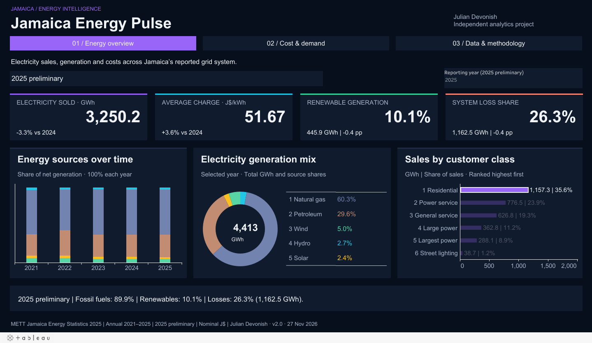
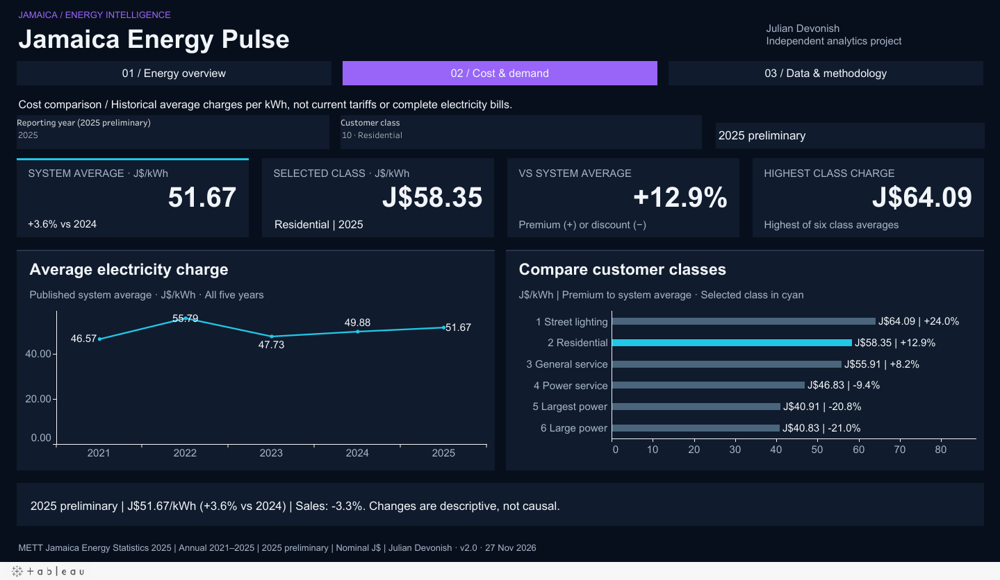
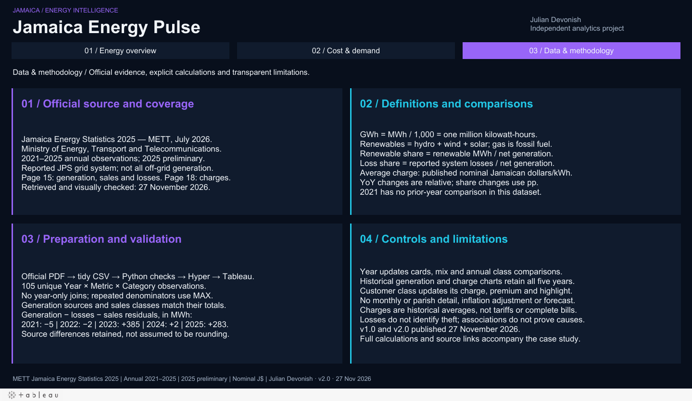

# Jamaica Energy Pulse

[Explore the dashboard](https://public.tableau.com/app/profile/jul.dev/viz/JamaicaEnergyPulse_17957981668130/01EnergyPulse) · [Download the final Tableau workbook](Jamaica%20Energy%20Pulse.twbx) · [Reproducible source bundle](Jamaica-Energy-Pulse-source.zip)

## Decision context

How has Jamaica's reported electricity generation mix changed, which customer classes account for sales, and how do published average charges compare? This independent portfolio project turns official annual tables into a readable, parameter-driven Tableau analysis. It supports questions for further investigation rather than prescribing energy policy or claiming causal effects.

## Official data and scope

The source is [Jamaica Energy Statistics 2025](https://www.mett.gov.jm/wp-content/uploads/2021/07/JAMAICA-ENERGY-STATISTICS-2025.pdf), published in July 2026 by the **Ministry of Energy, Transport and Telecommunications (METT)**. Page 15 supplies net generation by source, sales by customer rate class and system losses; page 18 supplies average rate charges. Data were retrieved on **27 November 2026**. The underlying providers are JPS and independent power producers.

The extract contains **105 unique Year × Metric × Category observations** for **2021–2025**. **2025 is preliminary.** The series describes the reported JPS grid system; it does not cover every off-grid or self-generated unit. All observations are real source values. No monthly, parish, customer-level or synthetic records are invented.

## What the three pages do

1. **Energy overview:** selected-year sales, average charge, renewable share and loss share; year-over-year or percentage-point context; historical generation composition; selected-year generation mix with a legend; ranked customer-class sales with shares.
2. **Cost & demand:** published system average, selected-class charge, its premium/discount and the highest class charge. The five-year system trend remains visible while the selected year changes the ranked class comparison. Cyan identifies the selected customer class.
3. **Data & methodology:** source coverage, metric definitions, preparation workflow, reconciliation and limitations.

The final design uses a **1440 × 810 (16:9)** canvas. The pages were simplified after review so the complete view, including navigation and source footer, fits in full screen. Larger Arial typography, fewer main charts and short explanatory subtitles replace crowded miniature plots.

## Calculations and grain

| Measure | Calculation |
| --- | --- |
| GWh | Source MWh / 1,000 |
| Renewable generation | Hydro + wind + solar; natural gas is excluded |
| Renewable share | Renewable MWh / published net generation MWh |
| Loss share | Published loss MWh / published net generation MWh |
| Sales change | (selected-year sales / preceding-year sales) − 1 |
| Charge change | (selected-year published average / preceding-year average) − 1 |
| Share change | Current share − preceding share, displayed in percentage points |
| Class premium | Class average charge / published system average charge − 1 |

The published system average is used directly. It is **not** the sum or unweighted mean of class rates. The long-form facts remain at their original grain. Generation sources are not physically joined to customer classes by year. Repeated annual denominator metadata is retrieved with **MAX**, not summed. The first year explicitly displays **prior-year data unavailable**.

## Findings from the 2025 preliminary data

- Reported sales were **3,250.2 GWh**, down **3.3%** from 2024.
- The published system average charge was **J$51.67/kWh**, up **3.6%** from J$49.88 in 2024.
- Hydro, wind and solar supplied **445.9 GWh**, or **10.1%** of net generation. Gas and petroleum supplied **89.9%**.
- Reported system losses were **1,162.5 GWh**, or **26.3%** of net generation. This does not identify their individual causes.
- Residential average charges were **J$58.35/kWh**, **12.9%** above the published system average. These are historical average charges, not current tariff quotes or complete bills.

## Validation

The checks cover all five years and **30 class/year combinations**. They verify unique facts, complete year coverage, positive source values, source-to-component totals, percentage bounds, preliminary flags, premiums, workbook ZIP/XML integrity and dashboard object boundaries. Tooltips use aggregate-safe year and category context instead of ambiguous ATTR fields. Year/class controls and navigation were also exercised in Tableau, including the 2021 missing-prior-year case. Published page images were inspected separately.

Generation-source values sum to net generation, and customer-class sales sum to reported sales. A different check—net generation minus losses minus sales—retains the following source discrepancies:

| Year | Difference (MWh) | Difference / net generation |
| --- | ---: | ---: |
| 2021 | −5 | −0.000116% |
| 2022 | −2 | −0.000045% |
| 2023 | +385 | +0.008253% |
| 2024 | +2 | +0.000044% |
| 2025 | +283 | +0.006413% |

These differences are preserved, not silently balanced or assumed to be rounding.

## Interpretation and limitations

Charges are **nominal Jamaican dollars**. No inflation adjustment, electricity bill calculator, actual JPS revenue estimate, price-elasticity estimate or forecast is presented. Changes in charges and sales do not establish causation. Losses combine multiple mechanisms and must not be equated with theft. The short annual series does not support monthly seasonality or robust forecasting. The source does not provide parish or household-income detail.

## Reproduce and inspect

The bundle contains the tidy dataset, source URL and hash, Python transcription/enrichment and validation code, analytical summaries, calculated fields and standalone workbook builder. Use Python 3 with `requests` and `tableauhyperapi`. Run `download.py`, `enrich.py`, `build.py`, then `validate.py`. `enrich.py` calls `prepare.py`; the 105 base facts are visible there for review against the PDF. The builder embeds a Hyper extract in the packaged workbook. The private workspace's optional Hyper runtime path is harmless when the package is installed normally.

## Version history

| Version | Date | Change |
| --- | --- | --- |
| v1.0 | 27 Nov 2026 | Initial public release |
| v2.0 | 27 Nov 2026 | Simplified 16:9 layout, comparisons, ranked classes, historical mix, dynamic findings and methodology |

This release replaces the superseded prototype; the links above point to the final publication. Optional chart-click parameter actions, a separate mobile layout and expenditure estimates are outside this release; native year/class controls remain explicit.

