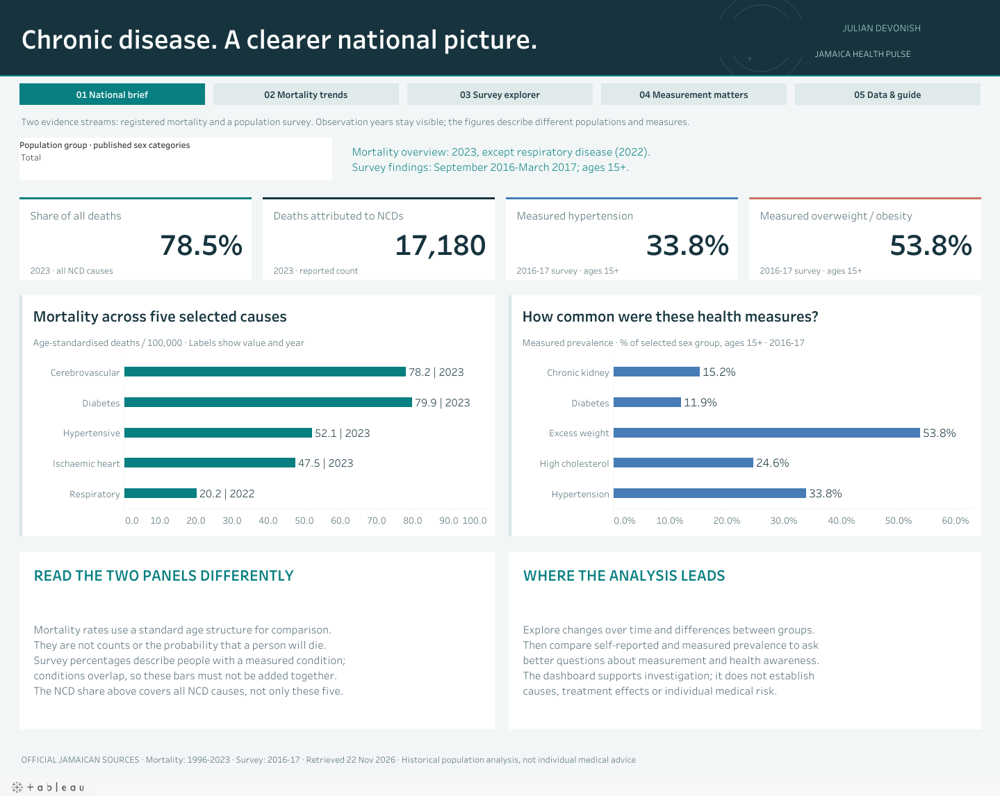
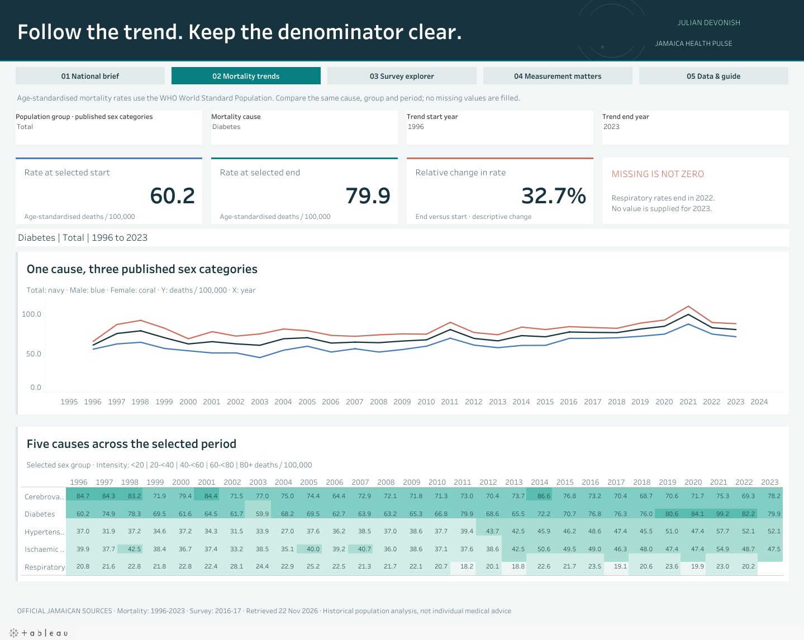
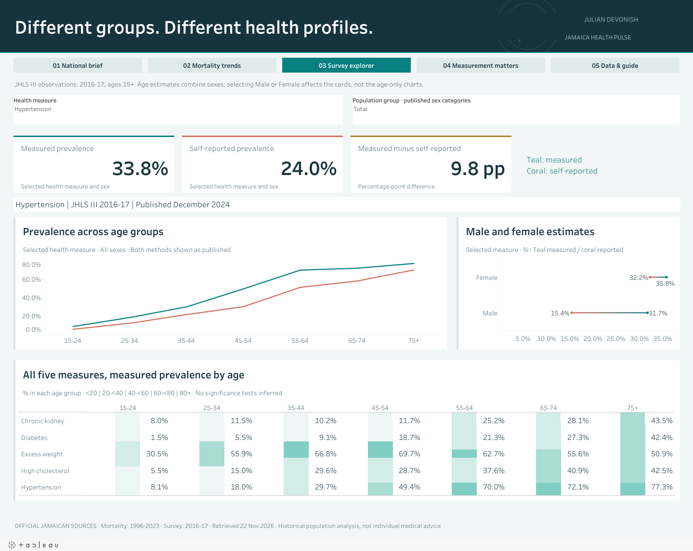
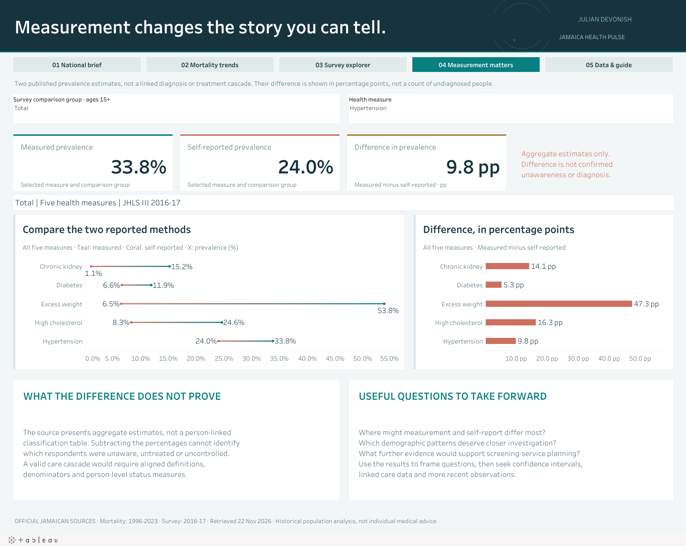
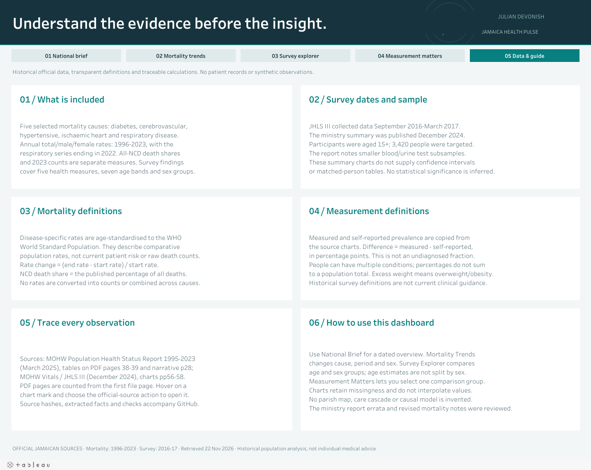

# Jamaica Health Pulse | Chronic Disease & Prevention

**Julian Devonish · Independent Tableau portfolio project · Published 22 November 2026**

[Explore the interactive dashboard](https://public.tableau.com/app/profile/jul.dev/viz/JamaicaHealthPulse/01NationalBrief) · [Download the packaged Tableau workbook](Jamaica%20Health%20Pulse.twbx) · [Preparation, calculations and validation](Jamaica-Health-Pulse-source.zip)

## The analytical question

How can Jamaica's published chronic-disease evidence be made easier to explore without confusing mortality rates, death counts and survey prevalence? This project turns two Ministry of Health & Wellness reports into five connected Tableau views. It supports public-health investigation and communication; it does not evaluate hospital operations, estimate individual risk or establish causes.

## What the data represents

| Evidence | Observation period | Coverage | Official source |
| --- | --- | --- | --- |
| Age-standardised mortality | 1996–2023; respiratory disease ends in 2022 | Five selected causes, Total/Male/Female | [Population Health Status Report 1995–2023, March 2025](https://www.moh.gov.jm/wp-content/uploads/2025/06/Jamaica-Population-Health-Status-Report-1995-2023_compressed.pdf#page=38) |
| All-NCD share of deaths | 2006–2023 | Published Total/Male/Female percentages | Same report, PDF pp38–39 |
| All-NCD death counts | 2023 | Total 17,180; Male 8,842; Female 8,338 | Same report, PDF p28 |
| Measured and self-reported prevalence | September 2016–March 2017 | Five health measures; seven age bands and three sex groups, ages 15+ | [Vitals / JHLS III, December 2024](https://www.moh.gov.jm/wp-content/uploads/2025/06/Vitals-10-JHLS-III-December-20248.5x11PRINT-UPDATED_compressed.pdf#page=56) |

Both official files were retrieved on 22 November 2026. Publication and retrieval dates are not observation dates. The survey targeted 3,420 people; biomarker subsamples were smaller, so this is not a uniform complete-case sample size. PDF page references count from the first file page.

The five mortality causes are diabetes, cerebrovascular disease, hypertensive disease, ischaemic heart disease and respiratory disease. Survey measures are diabetes, hypertension, high cholesterol, chronic kidney disease and overweight/obesity (displayed as **Excess weight** in some charts).

## From official reports to Tableau

1. Downloaded the official PDFs, recorded their URLs and SHA-256 hashes, and reviewed the mortality report's revision notes and errata.
2. Extracted mortality table values by PDF word coordinates so values remained aligned with their year, cause and sex columns. Preserved the absent respiratory 2023 observations rather than inserting zeros.
3. Visually transcribed the survey's chart values and cross-checked selected figures against the report's summary. Excluded stroke, whose summary total was inconsistent with its displayed sex estimates.
4. Standardised the data into a 574-record fact table: 417 mortality-rate observations, 54 NCD shares, 100 survey estimates and three NCD counts. Each record retains source URL, PDF page, period, unit and method.
5. Embedded a Tableau Hyper extract in a native packaged workbook with 25 worksheets, six parameters, calculated fields, source-link actions, SVG styling and navigation across five dashboards.

The data contains published aggregate observations, not patient records. No synthetic health outcomes, parish estimates or forecasts were generated. The source bundle includes curated numeric facts and original preparation code; full third-party PDFs and source-page images are not redistributed.

## Five views and how to read them

| View | Purpose | Controls / interpretation |
| --- | --- | --- |
| National Brief | Dated overview of NCD mortality and measured survey prevalence | Sex selection changes the displayed population; the two panels use different measures and periods |
| Mortality Trends | Compare a selected cause over time, plus a five-cause matrix | Cause, start year, end year and sex; the three-sex line chart deliberately shows all sex categories |
| Survey Explorer | Compare age patterns and sex estimates | Health measure and sex; the cards use the selected sex, while age estimates combine sexes because age-by-sex estimates were not supplied |
| Measurement Matters | Compare measured versus self-reported prevalence | Comparison group and selected measure; all five measures remain visible in the comparison charts |
| Data Guide | Explain coverage, dates, denominators, provenance and limitations | Read before interpreting results; hover on chart marks for evidence and official-source links |

## Calculations and validation

- **Mortality rate:** published age-standardised deaths per 100,000, directly standardised to the WHO World Standard Population. Rates are not raw counts and are not added across causes.
- **Relative rate change:** `(selected end rate − selected start rate) / selected start rate`. For total diabetes mortality, 60.2 in 1996 to 79.9 in 2023 gives approximately **32.7%**. Missing endpoints remain blank.
- **Prevalence:** published percentages, displayed as percentages using the correct scaling. The source's methods and denominators govern interpretation.
- **Percentage-point difference:** measured prevalence minus self-reported prevalence. Total hypertension is 33.8% versus 24.0%, a **9.8 pp** difference. This subtraction does not identify which people were undiagnosed, unaware, untreated or uncontrolled.
- **Latest available:** calculated separately by record type, measure and group. This keeps respiratory mortality labelled 2022 while other selected causes show 2023.
- **Aggregation:** individual published estimates use MIN/MAX at their intended grain, not sums across years or demographic groups.

Checks cover unique fact-table grain, expected row counts, plausible bounds, known report values and reconciliation of male plus female NCD counts to the total. Native Tableau checks confirmed parameter changes, navigation, endpoint missingness and the year-axis range. All five published dashboard images were downloaded and visually reviewed.

## What the evidence suggests—and what to investigate

The report attributes 78.5% of 2023 deaths to all NCD causes. In the older survey, measured hypertension was 33.8% and overweight/obesity 53.8% among adults aged 15+. These measures underline the value of exploring prevention and screening questions, while their different periods prevent a current, unified snapshot.

The survey charts show substantial age variation and differences between measurement methods. Useful follow-up questions concern which groups warrant closer investigation and what newer, linked evidence would be needed for service planning. The dashboard does not infer treatment effects, statistical significance or preventable-death totals.

## Limits that remain visible

- Survey observations are from 2016–17, despite a December 2024 publication date.
- The selected summary charts do not provide confidence intervals; subgroup differences are descriptive.
- Age and sex breakdowns are separate. There are no invented age-by-sex, parish or patient-level combinations.
- Conditions can overlap; prevalence percentages must not be added into a population total.
- Aggregate measured-minus-self-reported differences are not a clinical care cascade.
- Historical definitions are not current clinical guidance. The project is independent and does not imply ministry endorsement.

## Skills demonstrated

Official-source research, PDF extraction, data modelling, Python preparation, Tableau Hyper, LOD expressions, parameter-driven calculations, visual design, analytical validation and evidence-based documentation.

## Additional published views

