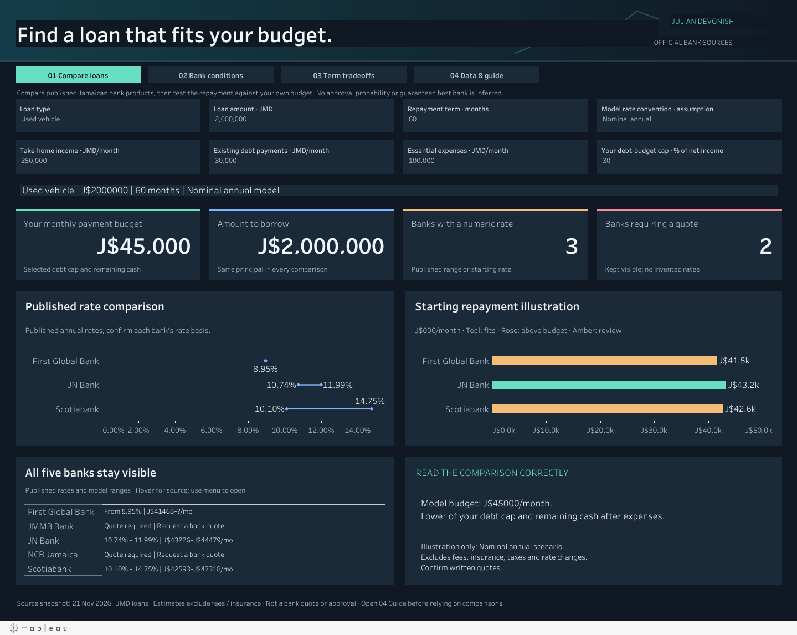

# Jamaica Loan Match — Technical Case Study

[Open the interactive Tableau Public dashboard](https://public.tableau.com/app/profile/jul.dev/viz/JamaicaLoanMatch/01LoanMatch)

An independent portfolio project by Julian Devonish. Compare published Jamaican loan products and explore how the same loan would fit a personal monthly budget. The dashboard supports a better-informed conversation with a bank; it does not predict credit approval or claim to identify the cheapest complete offer.

[Download the workbook](Jamaica%20Loan%20Match.twbx) · [Source and validation bundle](Jamaica-Loan-Match-source.zip)

## Explore the four views

1. **Compare loans:** published rate ranges, illustrative starting repayments, income-based budget and all five banks, including quote-only products.
2. **Bank conditions:** inspect rate definitions, documented employment requirements, product notes and the official source.
3. **Term tradeoffs:** compare monthly payments and modelled interest as the repayment term changes.
4. **Data & guide:** coverage, formulas, assumptions, missing information and interpretation.

Native navigation buttons connect the views. Parameters remain consistent when switching views. Hover over chart marks for evidence and use **Open official bank product page** in the tooltip action menu.

## Data and provenance

The curated snapshot covers **20 product entries across five banks and four loan purposes**: personal unsecured, new vehicle, used vehicle and home mortgage. Nine entries have numeric rates; eleven require a bank quote in the reviewed sources. The banks are JN Bank, Scotiabank Jamaica, First Global Bank, JMMB Bank and NCB Jamaica.

The data was retrieved from official bank rate tables and product pages on **21 November 2026**. Many source pages do not state an effective date, so this retrieval date does not certify that a rate remains available. `sources.json` records the URLs, retrieval date and SHA-256 hashes; `raw/` retains the retrieved evidence. `products.json` contains one curated record per bank/product.

`loans.csv` and the Hyper extract expand each product across 15 model terms and two rate endpoints: 600 scenario rows. These rows are a calculation scaffold, not observed loans, customers, applications or market-share data. No synthetic customer records are used. Published minima are never copied into missing upper bounds. Expired dealer promotions, unverified third-party estimates, JN's separate conditional iProtect product and NCB's fee-based digital products are excluded from numeric comparisons.

Primary sources include:

- [JN loan interest rates](https://www.jnbank.com/personal-banking/loans/loans-interest-rates/) and [mortgage rates](https://www.jnbank.com/personal-banking/mortgage/mortgage-rates/).
- [Scotiabank borrowing rates](https://jm.scotiabank.com/personal/rates-and-fees/borrowing-rates.html).
- [First Global pre-owned vehicle loan](https://firstglobal-bank.com/personal-banking/personal-loans/pre-owned-motor-vehicle-loan/).
- [JMMB loans](https://jm.jmmb.com/loans-overview).
- [NCB personal loans](https://www.jncb.com/personal/loans/).

See the manifest for all twelve source pages and the product records for the specific URL attached to each observation.

## Calculation model

Inputs are JMD principal, term in months, take-home monthly income, existing monthly debt payments, essential monthly expenses, a personal debt-budget cap, employment selection and rate convention.

For an annual percentage `a`, the user-selected common model convention is either:

- Nominal annual: `r = a / 1200`.
- Effective annual: `r = (1 + a / 100)^(1/12) - 1`.

Monthly payment is `principal × r / (1 - (1 + r)^(-months))`, with a separate zero-interest branch of `principal / months`. Modelled interest is `payment × months - principal`. The model assumes constant reducing-balance interest and equal monthly payments. Fees, insurance, taxes, payment holidays and rate resets are excluded.

Scotiabank labels its rates APR/EAIR, while the other reviewed sources use different annual/per-annum wording. Applying a common scenario convention is explicit sensitivity analysis; it does not establish that the original rates have equivalent contract definitions. Obtain comparable written quotations and full fee schedules before selecting a lender.

The monthly budget is:

`max(0, min(income × chosen cap / 100 - existing debts, income - existing debts - essential expenses))`

The default 30% is an editable personal-budget assumption, not a bank underwriting threshold. Colour distinguishes a full published range within budget, a starting estimate above budget, and conditions such as a range crossing the budget or an unknown upper rate. Documented term, principal and employment restrictions are flagged; age, credit history, collateral and full bank underwriting are not predicted. An unknown maximum term requires confirmation.

## Validation and design

The workbook contains 18 native Tableau worksheets and four dashboards, with an original SVG header, parameter controls, range lines, coloured repayment bars and term curves. It was opened and checked in Tableau Public Desktop 2026.3, then verified through the public interactive view and server-rendered images of all four dashboards.

Independent payment checks cover zero interest, a known amortisation case, effective versus nominal annual scenarios and expected ordering by rate. UI checks confirmed income-slider budget changes, rate-convention recalculation, bank selection and cross-dashboard navigation. The default used-vehicle example is J$2 million over 60 months, with income J$250,000, existing debts J$30,000, essential expenses J$100,000 and a J$45,000 model payment budget. `validation.json` records the numeric checks.

## Files and reproduction

- `Jamaica Loan Match.twbx`: final packaged Tableau workbook.
- `loan-match.png`, `bank-detail.png`, `term-tradeoffs.png`, `guide.png`: actual published Tableau renders.
- `prepare.py`: source retrieval, curated product records and scenario dataset.
- `build.py`, `navigation.py`, `actions.xml`: workbook construction and navigation/action definitions.
- `products.json`, `sources.json`, `calculated-fields.json`, `validation.json`: provenance and calculation evidence.
- `publication.json`: public URL and publication metadata.

`prepare.py` retrieves fresh web content but retains explicitly curated rate values; a refresh requires reviewing and updating those observations against the current sources. `build.py` uses the local Tableau Hyper API runtime under `work/tableau_runtime`. Do not treat rerunning the retrieval script as an automated rate refresh.

Use fictional financial values when sharing public screenshots or URLs. This project is not affiliated with or endorsed by any bank.
